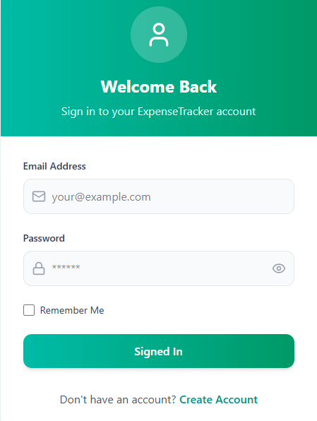
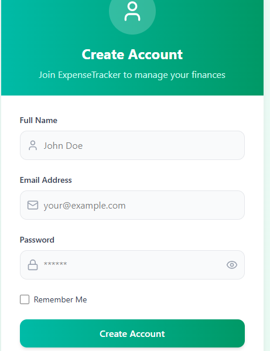
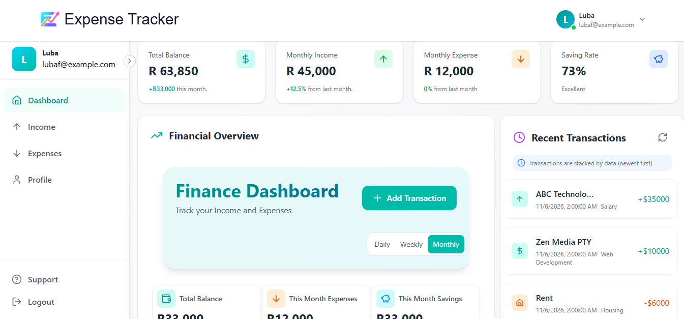
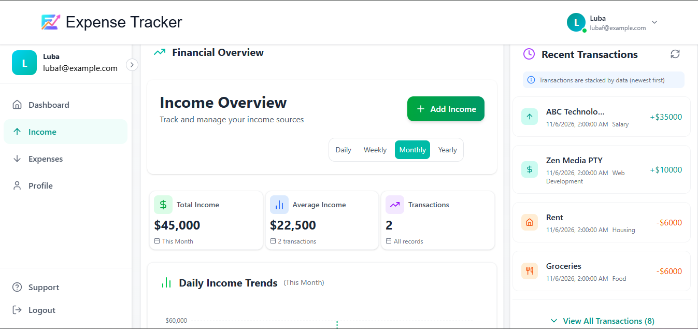
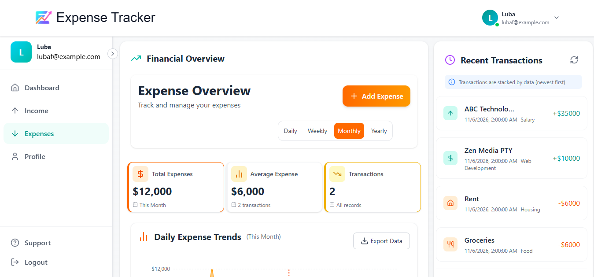
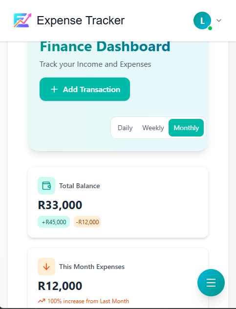
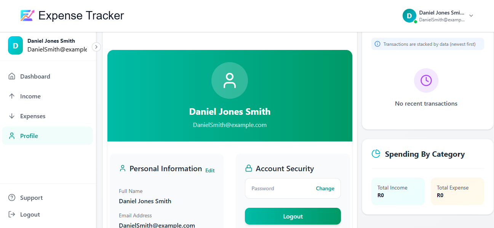

# 💰 ExpenseFlow

A full-stack expense tracking application that helps users manage their personal finances by recording income and expenses, organizing transactions, and monitoring their monthly spending.

Built as a practical full-stack project to demonstrate modern frontend, backend, database, authentication, API development, and deployment skills.

---

## 🚀 Live Demo

**Live Application:** (https://expense-flow-frontend-h0sq.onrender.com/login)

**Backend API:** (https://expense-flow-backend-8jp9.onrender.com/api)

**GitHub Repository:** (https://github.com/FodiDev/expense-flow)

---

## 📸 Preview

<!-- Add screenshots of your application here -->
## Login Page



## Sign Up Page



## Dashboard Page



## Income Page 



## Expense Page



## Mobile View Page



## Profile Page




---

## ✨ Features

### 🔐 User Authentication
- User registration and login
- Secure authentication
- Protected user-specific data
- Session management

### 💳 Transaction Management
- Add income transactions
- Add expense transactions
- Edit transactions
- Delete transactions
- Categorize transactions
- Track transaction dates
- Add transaction descriptions

### 📊 Financial Dashboard
- View total income
- View total expenses
- View current balance
- Monitor monthly spending
- Filter transactions by month
- Visualize spending by category

### 📈 Expense Analytics
- Category-based expense breakdown
- Monthly financial summaries
- Interactive charts
- Identify spending patterns

### 📱 Responsive Interface
- Responsive design for desktop, tablet, and mobile devices
- Clean and intuitive user interface
- Mobile-friendly transaction management

---

## 🛠️ Tech Stack

### Frontend

- **React**
- **JavaScript**
- **Vite**
- **Tailwind CSS**
- **Axios**
- **React Router**
- **Lucide React**

### Backend

- **Node.js**
- **Express.js**
- **MongoDB**
- **Mongoose**
- **REST API**

### Authentication

- Authentication system integrated into the application
- Protected API routes
- User-specific transactions

### Development & Deployment

- **Git**
- **GitHub**
- **Render**
- **MongoDB Atlas**

---

## 🏗️ Application Architecture

The application follows a client-server architecture.

```text
                    ┌──────────────────────┐
                    │      React App       │
                    │      Frontend        │
                    └──────────┬───────────┘
                               │
                               │ HTTP / REST API
                               ▼
                    ┌──────────────────────┐
                    │    Express Server    │
                    │       Backend        │
                    └──────────┬───────────┘
                               │
                               │ Mongoose
                               ▼
                    ┌──────────────────────┐
                    │       MongoDB        │
                    │        Atlas         │
                    └──────────────────────┘
```

---

## 📂 Project Structure

```text
expense-flow/
│
├── backend/
│   ├── config/
│   ├── controllers/
│   ├── middleware/
│   ├── models/
│   ├── routes/
|   ├── utils
    ├── package.json
│   └── server.js
├── frontend/
│   ├── public/
│   ├── src/
│       ├── assets/
│       ├── components/
│       ├── pages/
|       ├── utils/
|       ├── App.jsx
│       └── main.jsx
|   ├── package.json
|   └── vite.config.js
│
├── .gitignore
└── README.md
```

---

## 🔌 API Endpoints

The backend exposes RESTful API endpoints for authentication and transaction management.

### Authentication

| Method | Endpoint | Description |
|---|---|---|
| POST | `/api/user/register` | Register a new user |
| POST | `/api/user/login` | Authenticate a user |

### Transactions

| Method | Endpoint | Description |
|---|---|---|
| GET | `/api/get` | Retrieve user transactions |
| POST | `/api/add` | Add a transaction |
| PUT | `/api/update/:id` | Update a transaction |
| DELETE | `/api/delete/:id` | Delete a transaction |
| GET | `/api/downloadexcel/:id` | Download spreadsheet of a transaction |

> API endpoints may change as the application continues to evolve.

---

## ⚙️ Getting Started

Follow these instructions to run the application locally.

### 1. Clone the Repository

```bash
git clone https://github.com/FodiDev/expense-flow.git

cd expense-flow
```

---

### 2. Install Frontend Dependencies

```bash
cd frontend

npm install
```

---

### 3. Install Backend Dependencies

Open another terminal:

```bash
cd backend

npm install
```

---

## 🔐 Environment Variables

Create a `.env` file inside the `backend` directory.

```env
PORT=4000
MONGODB_URL=your_mongodb_connection_string
FRONTEND_URL=http://localhost:5173
```

Never commit your `.env` file to GitHub.

Your `.gitignore` should include:

```text
.env
node_modules/
```

---

## ▶️ Running the Application

### Start the Backend

From the `backend` directory:

```bash
npm run dev
```

The API should run on:

```text
http://localhost:4000
```

### Start the Frontend

From the `frontend` directory:

```bash
npm run dev
```

The frontend should be available at:

```text
http://localhost:5173
```

---

## 🌐 Deployment

The application is designed to be deployed as two separate services.

### Frontend

The React/Vite frontend can be deployed using platforms such as:

- Render
- Vercel

### Backend

The Node.js/Express backend can be deployed using:

- Render
- Railway

### Database

The application uses MongoDB Atlas for cloud database hosting.

When deploying, remember to configure the required environment variables on the hosting platform rather than committing them to the repository.

---

## 🧠 What I Learned

This project was built to strengthen practical full-stack development skills.

Through the project, I worked with:

- Building a React application from scratch
- Creating reusable React components
- Managing application state
- Connecting a frontend to a REST API
- Building RESTful backend endpoints
- Working with Express middleware
- Designing MongoDB/Mongoose models
- Implementing authentication
- Protecting user-specific resources
- Handling API errors
- Managing environment variables
- Implementing CORS
- Connecting MongoDB Atlas to a deployed backend
- Deploying frontend and backend applications
- Debugging production issues

---

## 🧩 Challenges & Problem Solving

One of the main goals of this project was not simply to build CRUD functionality, but to understand how a full-stack application works in a production-like environment.

Some of the challenges encountered included:

### CORS Configuration

The frontend and backend are deployed as separate services, which required configuring the backend to allow requests from the production frontend.

### Database Connectivity

Connecting the deployed backend to MongoDB Atlas required configuring the database network access and environment variables correctly.

### Environment Configuration

Development and production environments use different API URLs and configuration values, requiring environment-specific configuration.

### API Debugging

Testing API endpoints independently helped identify issues between the frontend, backend, and database layers.

These challenges provided practical experience with debugging applications beyond the local development environment.

---

## 🔮 Future Improvements

Planned improvements include:

- [ ] Receipt upload and receipt analysis
- [ ] AI-powered spending insights
- [ ] Automatic transaction categorization
- [ ] Monthly budget management
- [ ] Budget alerts
- [ ] Recurring transactions
- [ ] Export transactions to CSV/PDF
- [ ] Advanced financial analytics
- [ ] Improved dashboard visualizations
- [ ] Dark mode
- [ ] Improved accessibility
- [ ] Automated testing
- [ ] CI/CD pipeline

---

## 🤖 Future AI Receipt Insights

One of the planned features is an AI-assisted receipt analysis system.

Users will be able to upload a receipt and have the application extract information such as:

```text
Merchant: Example Store
Date: 31 August 2026

Items:
- Groceries       R350
- Household       R120
- Snacks           R80

Total:            R550
```

The system could then use this information to:

1. Create a transaction automatically
2. Categorize the spending
3. Update the user's monthly budget
4. Provide spending insights
5. Identify unusual spending patterns

---

## 🎯 Project Goals

The primary goals of this project were to build an application that demonstrates practical knowledge of:

**Frontend → API → Backend → Database → Deployment**

Rather than focusing only on individual technologies, the project focuses on understanding how the different layers of a modern web application work together.

---

## 👨‍💻 Author

**Lubabalo Fodi**

Junior Software Developer | React | JavaScript | Node.js | MongoDB

I'm passionate about building practical software solutions and continuously improving my skills in full-stack web development.

---

## 📄 License

This project is available for educational and portfolio purposes.
